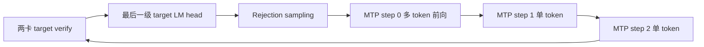

# Qwen3.8 Flash-Next AutoRound：MTP 流程调查

## 范围和可回退基线

本轮使用 `/media/z/data6/models/Qwen3.8-Flash-Next-W4A16-AutoRound`，
CMP170HX SM80，物理 GPU 2/3、PCI bus 顺序、PP2/TP1、`26,22` 分层。
用户本轮把目标从 MTP-off decode 切到 MTP；DeepSeek 服务继续保持关闭。
MTP-off 的已验证启动命令和源码哈希保存在本轮 `rollback-launch.json`。

测量目录：`artifacts/qwen38-autoround-mtp-20261006/`。诊断服务使用
`127.0.0.1:26662`，不作为最终普通 API 服务。启动复用已验证的 0.90
显存比例、CPU PLE 和 QSA 合并投影/准备。MTP3 基线显式关闭 M1 MoE
alignment，防止和上一轮的 MTP-off 优化混淆。

## 实际执行路径



V2 runner 在最后一个 PP rank 创建 `MTPSpeculator`。草稿模型是独立的
本地 PP1 `Qwen4ExpMTP`，复用同一个 MTP 层；不是每个预测 token
各有一个不同层。target 把 HC 的四路残差交给草稿模型，草稿每次返回
用于 LM head 的合并状态和用于下一步的四路状态。CPU PLE 只属于
target 第 2 层，草稿不执行 PLE。

MTP3 的 target decode query length 为 4。草稿第一步沿用 target 的
query 布局，包括拒绝后保留的填充位置，只在每个请求的有效末尾
采样；后续两步每请求一个 token。`AutoRegressiveSpeculator` 根据
backend 的 `supports_draft_decode_metadata_update` 判断能否把后续
两步放入同一个 CUDA Graph。需要以运行时 inventory 确认实际模式。

已有草稿 FP8 LM head 是 SM80/TP1/BF16、词表 248320、hidden 2560、
未绑定 embedding 的专用路径，target LM head 仍为 BF16。
`mtp.py` 显式传递 `enable_sm80_hc_down=False`，因此 target 的 HC
SM80 开关不能自动优化草稿。

## 测量方法

固定提示使用已有的精确 1024/32768 token needle 输入；并发 4
使用四个各 1024 token 的独立提示。每次输出 256 tokens，greedy、
seed 42、`ignore_eos`，通过独立 cache salt 排除 prefix hits。
保存 SSE token IDs、块时间、显存/功耗和草稿计数。

正式速度以首个输出块到最后输出块的 tokens/s 和并发共同 decode
窗口为准。同时记录接受率及 `1 + accepted_tokens / drafts`；仅加快
草稿但降低接受率，不足以证明整机提速。配对实验按 AB/BA 交替，
在同一已加载实例上保留并切换两套图。

阶段测量使用 CUDA Events，细分图内投影、HC、QSA、MoE、草稿
LM head；事件记录和同步只用于诊断，诊断请求不计入正式测速。
嵌套事件和重叠流不能直接相加作为互斥耗时。微基准保留图和输出
缓冲，预热并交替计时，先校验真实权重的输出。

## 候选和验收

- 草稿 HC down：复用现有 SM80 精确形状 `[M,10240] × [336,10240]`
  核，只支持 M=1/4，其他形状继续走标准 linear。先真实权重微基准，
  再重新编译和捕获草稿图、配对整机实验。
- 草稿 QSA 索引复用：step 0 选择每个请求有效末尾的索引，后两步
  复用，同时继续更新 KV/压缩缓存。需要测实际接受率和并发语义，
  不能把跳过 top-k 的局部收益当作整机收益。
- K=1/2/3：先用各位置接受率与阶段成本判断收益，完整服务验证
  后才能推荐改变 K。V2 草稿循环固定以实例的最大 K 为边界，不能
  只改一个 Python 属性或调度表就宣称完成了较小 K 的公平 A/B。

只有完整服务中验证收益并通过语义/工具/长提示检查的候选才推广。
未通过或没有稳定收益的实验保留证据，维持回退路径。

## 源头提交审计

目标 checkout 为 `e2e327dc53b93acb85c8b56b526d369eb5461421`，并包含
此前的本地 Qwen 修改；本轮没有把它描述为干净发布版本。
源头 `/mnt/data/apps/vllm` 为 `31ebe18bb63303be83137a59f668ca9812ac3579`，
本地缓存 `origin/main` 为 `0e468adb43d60484b5a6546e0124b686fd76baf3`，
未 fetch，因此审计边界是这些本地提交。

- `a311916a291c1fed3dbfb72e60f74cd778c8419d`，MRV2 将后续 AR
  draft steps 合入一个 CUDA Graph：已在目标 HEAD 的祖先中。
- `3e174bb73c70b677dd339c59c39d7460abc5d02d`，MTP top-k 索引
  复用：已在目标 HEAD 的祖先中。当前模型配置默认关闭，不能从
  提交存在推断它已经在当前服务执行。
- QSA backend 的 metadata update 能力存在且当前运行时启用。
  本轮 inventory 实际记录 `fused_steps=true`，三个 draft attention
  groups 全部支持更新。历史其他模型/PP3 的 `false` 不适用于这里。
- scheduler 的 dynamic SD 字段没有接入 V2 proposer 的固定 K 循环；
  因此不使用调度表或修改单个实例属性冒充 K=1/2 的实测。
- startup 权重缓存、非 QSA 的 FlashInfer attention 路径和其他硬件
  专用提交没有作为当前 MTP decode 优化移植。

相关执行源码：
`vllm/v1/worker/gpu/spec_decode/autoregressive/speculator.py`、
`vllm/v1/worker/gpu/spec_decode/mtp/speculator.py`、
`vllm/models/qwen4_exp/common/qsa_cache.py` 和
`vllm/models/qwen4_exp/nvidia/mtp_fp8_lm_head.py`。

## 基线与热点

以下是本轮 MTP3 基线，一次预热、三次正式波次，输出 256 tokens：

| 输入 tokens | 并发 | Decode tok/s 中位数 | 接受率 | 平均接受长度 |
| ---: | ---: | ---: | ---: | ---: |
| 1024 | 1 | 100.07 | 50.98% | 2.529 |
| 32768 | 1 | 80.10 | 33.60% | 2.008 |
| 1024 | 4 | 332.09 | 49.35% | 2.481 |

单路使用首个输出块之后的吞吐；四并发使用四个请求共同 decode
窗口的总吞吐，不能与单路直接作为每请求速度比较。
自由文本部分即使同一个 baseline 重复也会变化，32K 后续波次的
接受率较高，吞吐也上升。这不是与旧波次比较即可认定的优化收益。

CUDA Event 粗阶段测量，单位毫秒；这些是诊断请求的阶段耗时，
包含事件之间的排队及 CPU 提交节奏，不能相加推导互斥占比：

| 输入/并发 | PP0 target forward | PP1 target forward | Target LM head | Draft step 0 | Draft steps 1+2 | Draft proposal |
| --- | ---: | ---: | ---: | ---: | ---: | ---: |
| 1K / 1 | 7.282 | 6.099 | 0.783 | 0.971 | 1.582 | 2.590 |
| 32K / 1 | 7.546 | 6.366 | 0.783 | 1.009 | 1.649 | 2.695 |

图内细分测量显示 draft LM head 三次调用约 `0.415 + 0.831 = 1.246 ms`，
是草稿内最主要的单项开销。其 FP8 packed weight 为约 636 MB，
target head 仍为 BF16。实际 microbenchmark 和 serving 阶段都支持
优先调查 draft head，不能把 CPU PLE 归入草稿热点。
细分事件会扰动小算子及重叠流，不用其各项总和计算精确占比。

C4 诊断波次实际观察到 1+3 个请求的调度批次；capture descriptor
为 16 tokens/4 requests 的 draft prefill 图未被该波次 replay。
因此没有把该图的空记录解释为完整四请求批次的零耗时。

## 同实例配对实验

所有正式实验都关闭阶段事件，保留 baseline 和候选图对象、输出及
缓冲，在空闲时切换，按 AB/BA 交替；以下增益是逐对比值的中位数，
不是两个吞吐中位数的比值。

| 候选 | 工作负载 | 配对数 | 吞吐增益中位数 | 结论 |
| --- | --- | ---: | ---: | --- |
| Top-k sharing 首轮 | 1K / C4 | 4 | +1.59% | 进入复测 |
| Top-k sharing 复测 | 1K / C4 | 8 | +0.25% | 未复现稳定收益 |
| Top-k sharing 复测 | 128K / C1 | 4 | -0.82% | 不推广 |
| BF16 draft head | 1K / C1 | 4 | +0.03% | 不推广 |
| BF16 draft head | 32K / C1 | 4 | -1.51% | 不推广 |
| BF16 draft head | 1K / C4 | 4 | -0.74% | 不推广 |
| 逐步 decode 首轮 | 1K / C1 | 4 | +4.69% | 进入复测 |
| 逐步 decode 复测 | 1K / C1 | 8 | -0.32% | 首轮增益未复现 |
| 逐步 decode 复测 | 128K / C1 | 4 | +5.36% | 接受长度变化，不作为路径提速推广 |
| INT4/g32 draft head | 1K / C1 | 4 | -3.01% | 不推广 |
| INT4/g32 draft head | 32K / C1 | 4 | -4.03% | 不推广 |
| INT4/g32 draft head | 1K / C4 | 4 | -1.78% | 不推广 |

完整每对结果、每位置接受数和原始吞吐在 `analysis.json` 及各
`*.jsonl` 中，未剔除不利样本。

### 逐步路径的反证

128K 配对增益为 `[+10.529, +2.072, +8.652, -2.204]%`。
`mean_accepted_length / decode_tok_s` 只是每轮成本的近似诊断量，
同时受首尾块、截断和排队影响；其配对中位数仅下降 0.63%。
不能用它声称草稿 GPU 耗时减少 5.36%。

独立阶段 AB/BA 证明候选实际 replay 两次单步图，baseline replay
一次包含两步的图。1K 候选 decode loop 约 1.597–1.603 ms，baseline
约 1.575–1.576 ms；128K 候选约 1.695–1.698 ms，baseline
约 1.674–1.679 ms。候选 proposal 同样略慢，因此保留 fused path，
没有新增默认关闭融合的环境变量。

### INT4 head：局部提速没有兑现整机收益

仅使用 target 的真实 BF16 head 权重构造独立草稿 head，target 权重
和方法不变。量化为 round-to-nearest、对称 INT4、group 32，不宣称
它是经过校准的 AutoRound head。按词表分块量化避免一次性巨额临时
分配，使用现有 Marlin repack/kernel。

与独立反量化 BF16 参考相比，native 输出 relative L2 为 0.00275，
最大绝对误差 0.000488；与原 BF16 head 相比，随机输入 logits
relative L2 为 0.10045。这两种误差分别验证 kernel 实现和描述量化
近似，不能混为同一正确性指标。

| Shape | FP8 head us | INT4 head us | 局部耗时变化 |
| --- | ---: | ---: | ---: |
| M1 × H2560 | 424.78 | 303.59 | -28.53% |
| M4 × H2560 | 429.62 | 307.06 | -28.53% |

每图 8 次调用，11 轮 AB/BA、每轮 16 次 replay，预热并保留输出。
图内/服务微基准期间内存对象保持存活。INT4 weight+scales 为
357580800 bytes。另一次服务阶段 AB/BA 中，proposal 从约 2.588 ms
降到 2.178 ms，说明该候选确实触达服务草稿路径；正式吞吐却下降，
接受率及输出变化抵消了局部收益。该候选留在诊断产物，没有修改
生产 head 或模型配置。

### 其他微基准

真实 FP8 head 的 M1/M3/M4 native Marlin launch plan 比较中，默认
约 423/428/428 us；强制 128/128/256 为 421/427/425 us，差异不足
1%，其他合法计划更慢，两种计划不受支持。保留默认选择。

两个实际 HC `[336,10240]` 权重，M1 标准 linear 约 10.35 us，现有
native kernel 约 5.1 us；M4 从约 8.9 us 降到 7.5–8.0 us。
四个对比中三个 bitwise 相同，一个最大绝对差为 1.91e-6。
即使乐观地把两层、三步的局部收益全兑现，也只是约 24 us/轮；
而 microbenchmark 是反复读同一权重的缓存状态。没有为这个局部
结果额外跑整机实验或开启草稿 HC，也没有把它作为整机增益推广。

## 验证和推广边界

七个正式 campaign 共 306 个请求，均正确取回 needle、固定输出
256 tokens、无特殊输出 token、prefix hits 为 0，MTP 计数增长。
这覆盖本次固定文本场景，不是完整模型质量评估。
31 个 Qwen4Exp config/FP8-head 测试通过：

```bash
.venv/bin/python -m pytest \
  tests/models/qwen4_exp/test_config.py \
  tests/models/qwen4_exp/test_mtp_fp8_lm_head.py -q
```

一次 512-token baseline 预热触发特殊 token 断言，没有进入正式配对。
该请求未被完整写入 jsonl，不能据此识别具体 token 或证明根因。
相关失败日志保留，速度/语义结论限制在 256-token 正式请求。
两个 Marlin plan 调试 RPC 参数/模块重载错误和一次 INT4 权重访问
属性错误已修正；服务继续健康，没有把这些失败算入正式速度。

本轮未发现可默认推广的新 MTP 执行优化。最终选择已验证的
**MTP3 + FP8 draft head + fused multi-step + 不复用 top-k indices**。
启动脚本默认 `MTP_TOKENS=3`，保留 `MTP_TOKENS=0` 回退；此前 QSA
merged/fused prepare 优化继续开启，M1 expert alignment 不随 MTP3
自动开启，GDN standard decode 仍关闭。最终普通 API 使用
`0.0.0.0:26661`，关闭 dev RPC、worker extension 和诊断 PYTHONPATH。

K=1/2 的公平整机验证需要各自重新创建配置和捕获图；本轮未测。
后续若研究较小 K，应优先用本轮每位置接受数判断边际收益，再做
最小 bounded serving 对比。未验证 full 256K 输入或四路 full 256K
容量；诊断 MTP3 启动 KV 估计约 980560 tokens/3.74 倍 256K，最终普通
服务的启动估计为 1028738 tokens/3.92 倍 256K，不能
据 `max_num_seqs=4` 宣称四路满上下文已验证。

最终服务的启动、健康、工具、并发和 128K 复查记录在同目录的
`launch-final.json`、`server-final.log`、`smoke-summary.json`、
`final-probes.jsonl` 和 `runtime-final.json`。DeepSeek 保持关闭，
诊断图及临时权重随诊断进程退出释放。

### 最终普通服务复查

- `qwen38-autoround-manual.service` 为 active/running，API PID 4155487，
  PP0/PP1 GPU workers 为 4159565/4160096，同属于该 unit cgroup。
  `/health`、`/v1/models` 返回 200，served model identity 和 262144
  配置一致；dev RPC 路由返回 404，命令没有 worker extension。
- 默认 thinking 算术、自动天气工具调用、四路同时算术共 6/6 通过。
- 1K/128K 各一次、输出 256 tokens 的 needle 复查通过，prefix hits
  为 0，无特殊输出 token，draft/acceptance 计数正常增长。
  单次 decode 分别为 101.06/87.70 tok/s，平均接受长度 2.500/2.142。
  这些是重启后的功能复查，不是与诊断阶段配对的提速证据。
- 结束时 GPU 2/3 总显存占用约 58305/59079 MiB；唯一的两个 compute
  processes 正是上述 PP workers。GPU 1/4/5/6 各 6 MiB，DeepSeek
  unit 为 inactive、MainPID=0；诊断 unit 已被 systemd collect。
- 最终源码哈希与 `launch-final.json` 一致；与本轮诊断基线相比，
  被记录的执行源码仅启动脚本默认 K 从 0 改为 3。MTP kernel、head、
  speculator 未改。shell syntax、MTP3/MTP0 的 CHECK_ONLY、三个交付
  文件的 pre-commit 和 `git diff --check` 全部通过。

## 后续全流程拆分

本报告的既有 head/index/fused-step 实验保留为历史证据。
PP 草稿回收同步的定位、独立阶段测量与正式推广结果见
[MTP 流程拆分与 PP 回收优化](qwen38-autoround-mtp-phase-breakdown-2026-10-06.md)。
