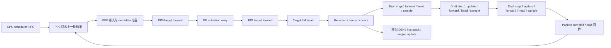

# Qwen3.8 AutoRound MTP 流程拆分与 PP 回收优化

日期：2026-10-06。目标为本地
`/media/z/data6/models/Qwen3.8-Flash-Next-W4A16-AutoRound`，
物理 GPU 2/3（CMP170HX、SM80、各 64 GiB），PP2/TP1、分层 `26,22`。
MTP3，主 LM head BF16、draft LM head FP8、fused multi-step 开启，
top-k sharing 关闭。保留 CPU PLE、QSA 优化、prefix caching、
262144 最大长度、四个序列、4096 batched tokens 和 0.90 显存利用率。
DeepSeek 在本轮保持停止。

## 结论和正式推广

PP0 回收上一轮 draft 时，原路径无条件使用 GPU 布尔索引：

```python
valid = idx_mapping >= 0
draft_tokens_to_update[idx_mapping[valid]] = draft_tokens[valid]
```

布尔索引的输出长度由 GPU 决定，PyTorch 必须同步获得该长度。
这使 CPU 等待上一轮 target、采样、draft 和回传，随后才准备下一轮。
改为固定形状的 Triton masked scatter，按请求槽直接回写三个 draft，
跳过 `-1` 槽，保留 main stream 对回传 event 的等待。
GPU 依赖没有移除；CPU 能提前提交下一轮准备工作。

同一加载实例、关闭所有记录的四组 AB/BA 对测量：

| 输入 | 并发 | 原路径 tok/s 中位数 | 回收优化 tok/s 中位数 | 配对收益中位数 | 归一化轮成本变化 |
| ---: | ---: | ---: | ---: | ---: | ---: |
| 1024 | 1 | 94.94 | 143.85 | +51.60% | -32.33% |
| 32768 | 1 | 77.54 | 106.35 | +38.51% | -31.13% |
| 1024 | 4 | 305.31 | 397.77 | +31.76% | -24.23% |

单请求表项为 decode throughput；四并发表项为四个请求共同 decode
窗口内的总 throughput。配对收益取各对的比值中位数，
因此不等于两列中位数的比值。每组四对均为正收益。

正式 launcher 默认只启用回收优化。延迟 PP 接收和 GDN metadata
简化保留各自实验开关，默认关闭：修复回收后，它们的额外收益没有
达到稳定推广的证据要求。库中三个开关均默认关闭。

## 源头审计和执行顺序

目标 checkout 为 `e2e327dc53b93acb85c8b56b526d369eb5461421`，
源头 `/mnt/data/apps/vllm` 为 `31ebe18bb63303be83137a59f668ca9812ac3579`。
本轮使用本地提交和源文件，没有把缓存的 origin/main 当成已刷新远端。

源头 `6fe67cbbf3e43da89bebf6ab0eeaca4ba6c75663`
（MTP under pipeline parallelism，#46994）的
`PPHandler.get_prev_sampled_outputs` 在通常没有请求被排除时直接用
整数 request index 回写 draft；仅排除请求时进入过滤分支。
本地 packed relay 的 runner 回写无条件进入 GPU 布尔索引。
本轮吸收其保持常规回收异步的原则，同时适配本地 packed relay，
没有替换本地 PP 通信协议。

源头 `024c957a6e67199f40d67e870d4c034502879e8f`
（#58542）跳过已经离开 engine 的请求广播。保留本地请求槽 generation
检查和 `-1` 槽语义；异步回写没有绕过这些判断。
既有 fused multi-step 和 top-k sharing 源头优化已在前轮审计，
本轮不重复移植，也不开启前轮未通过服务测试的候选。

一个稳态轮次的逻辑顺序如下。draft 生成下一轮提议，target 一次计算
本轮的三个候选及 bonus 位置；接受判断发生在整个 target forward 之后。



图表示依赖，不表示所有节点串行占用 GPU。两个 PP rank、main stream、
relay stream、输出 copy stream、CPU 输出线程分别记录；输出 D2H
可与 draft 重叠，下一轮 CPU 准备可与上一轮 GPU 计算重叠。

## 全流程测量方法

记录和吞吐分开：硬件请求使用现有加载实例；每个记录窗口为
40-token 预热和 128-token 测量。正式吞吐为 256 tokens、temperature 0、
seed 42、ignore EOS、独立 cache salt，prefix hits 必须为 0。
保留 prompt/token IDs、原始 SSE 时间、MTP counters 和 needle 检查。

GPU 采用 CUDA Graph 内可 replay 的 globaltimer 环形记录，
按 rank、stream、step、嵌套 scope 对齐，避免重复 replay 覆盖 CUDA Event。
细分 draft 0/1/2 的 forward、LM head、采样、输入更新、slot mapping
和 attention metadata 更新；fused step 1/2 仍能分别读取。
跨 rank 通过 host/GPU 时间校准对齐，典型不确定度约 56–62 us。
细粒度区间含记录本身开销，不能把数 us 的项当作零开销内核计时。

CPU 使用 monotonic wall time 和 thread CPU time，独立记录 scheduler、
executor IPC、Future 等待、worker、输入准备、各 attention builder、
rejection、draft 提交和输出 pack。CPU-only 窗口不开 GPU 时间戳，
用于避免 GPU marker 对 metadata/提交阶段的扰动。

每个 scope 同时保留 inclusive、扣除直接子区间并集后的 exclusive。
跨 rank 轮账从 PP0 forward 开始到下一次 PP0 forward 开始，
使用区间并集拆分重叠和间隙。1047 个轮账全部守恒，汇总无警告。
不能把父/子 inclusive、CPU/GPU 时间或跨 stream 时间直接相加。
`recv_object` 和 NCCL completion 包括生产者等待，不能视为纯链路耗时。

## 独立阶段结果

### 单请求 GPU 区间

下表为细分窗口的区间中位数，单位 ms。
forward/head 为 CUDA Graph 内区间；采样 exclusive 扣除 LM head。
这些是诊断值，正式收益以不记录的 A/B 为准。

| 阶段 | 1K | 32K |
| --- | ---: | ---: |
| PP0 target forward | 7.250 | 7.512 |
| PP1 target forward | 6.116 | 6.291 |
| Target LM head | 0.782 | 0.782 |
| Target rejection inclusive | 0.088 | 0.088 |
| Draft 0 forward | 0.521 | 0.558 |
| Draft 0 LM head | 0.413 | 0.413 |
| Draft 0 sampling exclusive | 0.016 | 0.016 |
| Draft 1 forward | 0.351 | 0.385 |
| Draft 1 LM head | 0.413 | 0.413 |
| Draft 1 sampling exclusive | 0.018 | 0.018 |
| Draft 2 forward | 0.350 | 0.383 |
| Draft 2 LM head | 0.413 | 0.413 |
| Draft 2 sampling exclusive | 0.018 | 0.018 |
| Draft 1 input update / slot mapping | 0.009 / 0.005 | 0.009 / 0.005 |
| Draft 2 input update / slot mapping | 0.003 / 0.005 | 0.003 / 0.006 |
| Draft proposal inclusive | 2.665 | 2.770 |

每步 QSA state metadata 更新约 2–4 us；step 1/2 各有多个 metadata
更新 scope。完整数据按 attention group 保存，未合并成一个 MoE 热点。
三个 draft LM head 合计约 1.24 ms，是 draft GPU 时间的重要组成。
前轮 INT4/g32 head 曾降低 proposal 时延，但服务吞吐下降，故不推广。
本轮保持 FP8 draft head，未修改量化、MoE 数学、LM head 或接受策略。

### CPU 准备、等待和输出

下表来自同一实例的 CPU-only 窗口，单位 ms，中位数。
metadata 为所有 builder 调用的父 scope；原路径和回收优化均有记录开销。

| 阶段 | 1K 原路径 | 1K 仅回收优化 | 32K 原路径 | 32K 仅回收优化 |
| --- | ---: | ---: | ---: | ---: |
| PP0 update_pp_decode_requests inclusive | 19.249 | 0.388 | 20.079 | 0.383 |
| PP0 prepare_inputs | 0.585 | 0.711 | 0.606 | 0.703 |
| PP0 metadata_build inclusive | 3.937 | 5.245 | 4.076 | 5.226 |
| PP1 prepare_inputs | 1.218 | 0.836 | 1.253 | 0.885 |
| PP1 metadata_build inclusive | 6.858 | 5.043 | 7.097 | 5.263 |
| PP1 draft proposal CPU submission | 0.918 | 0.632 | 约 0.9 | 0.663 |

准备开销依旧存在，而且移除 CPU 同步后可提前与上一轮 GPU 重叠；
不能将回收 wall time 降低约 19 ms 当成每轮 GPU 加速 19 ms。
正式 A/B 中单请求归一化轮成本约降低 31%–32%。
布尔索引等待中的 thread CPU time 也很高，包含 CUDA driver 的等待/轮询，
不能据此把它归为模型 CPU 计算。

CPU-only 1K 窗口中 scheduler.schedule 约 0.121 ms，
update_from_output 约 0.058 ms；异步 executor 提交约 0.07–0.13 ms。
Engine/Future 等待为父区间，不能与 worker 时间再次计入轮账。
输出 copy_wait_and_pack 使用线程 CPU 时间区分等待与 pack：
优化后会较早进入等待，因此其 wall time 变长不代表输出 copy 变慢。
GPU D2H 本身是约十几 us 的区间，可与 draft 重叠。

密集 GPU 记录曾使 metadata 父区间达到 5–8 ms；这种区间还包含
CPU 提交间隙和记录开销，不是 metadata 内核占用 GPU 的纯时间。
已补充 CPU-only 测量，未用这些密集记录的吞吐估算正式收益。

## 实验拆开与淘汰

所有单项 A/B 分别关闭其他两个候选，四组 AB/BA 对/工作负载。

| 候选 | 1K/C1 配对收益 | 32K/C1 配对收益 | 1K/C4 配对收益 | 处理 |
| --- | ---: | ---: | ---: | --- |
| 固定形状 PP draft 回写 | +51.60% | +38.51% | +31.76% | 正式默认开启 |
| 延迟 PP receive、先准备输入 | +13.47% | +10.08% | +0.31% | 独立实验开关，默认关 |
| GDN 纯 spec prefix 切片 | +6.19% | +10.71% | +4.65% | 独立实验开关，默认关 |
| 三项组合相对原路径 | +45.37% | +50.90% | +24.80% | 不作为默认组合 |
| 三项组合相对仅回写优化 | +1.37% | +1.27% | +0.88% | 正负混合，无稳定增量 |

组合相对仅回写的归一化轮成本中位变化为 -0.17%、-1.13%、-0.52%。
回写修复已经隐藏大量准备工作，因此不能把独立收益相加。
GDN 的掩码在 CPU；独立排队实验确认它不具有 GPU bool 索引的 D2H
长度同步。其切片候选只减少分配、CPU 掩码处理和 GPU 提交开销。

正式回写 A/B 的 32K draft 接受率从约 0.308–0.341 变为
约 0.283–0.306，吞吐依旧全部提高，且归一化轮成本明显降低。
1K 接受率约 0.48–0.52；32K 较低接受率仍限制收益，但本次提速不能
解释为接受率提高。`L = 1 + 3a`，用 `L / decode_tok_s` 比较轮成本。
四并发该量仅为按请求聚合的成本指标，不等于一个 PP batch 的时长。
MTP0 约 80 tok/s 属于前轮记录，未在本轮重新加载作严格 on/off 对照。

## 代码、范围和回退

- `vllm/v1/worker/gpu/qwen_mtp_utils.py`：共同资格判断和 masked scatter。
- `vllm/v1/worker/gpu/model_runner.py`：回写选择，非目标回原 GPU bool 路径。
- `vllm/v1/worker/gpu_worker.py`：独立 prepare-ahead 实验开关。
- `vllm/v1/attention/backends/gdn_attn.py`：独立 prefix metadata 实验开关；
  仅纯 spec 且 mask 确认为前缀时切片，混合/非前缀保留原过滤。

共同 gate 要求显式 JSON boolean、CUDA SM80、qwen4_exp、
hidden 2560 / 48 layers / 512 experts、INC/BF16、PP2/TP1/DP1/PCP1、
MTP3、无 adaptive verification、max_num_seqs 不超过 4、FULL graph。
未满足者走原路径。本次服务证据只针对上述 checkpoint 和 `26,22` 分层，
没有把它扩展成其他模型、GPU、拓扑或 K 的性能结论。

launcher 的三个独立变量及对应 additional_config：

| 环境变量 | 默认 | additional_config |
| --- | ---: | --- |
| QWEN_MTP_PP_OPTIMIZATIONS | 1 | qwen4_exp_mtp_pp_optimizations |
| QWEN_MTP_PREPARE_AHEAD | 0 | qwen4_exp_mtp_prepare_ahead |
| QWEN_MTP_PREFIX_METADATA | 0 | qwen4_exp_mtp_prefix_metadata |

回退回收优化：

```bash
QWEN_MTP_PP_OPTIMIZATIONS=0 \
  scripts/serve_qwen38_flash_next_autoround_cmp170hx_pp2.sh
```

需在重启时生效。`MTP_TOKENS=0` 保留原 MTP-off 配方，三个新 gate
全部不启用。诊断 worker/RPC/时间戳不进入普通服务。

## 验证与输出边界

`tests/v1/worker/test_pp_utils.py` 和
`tests/v1/attention/test_gdn_metadata_builder.py` 合计 63 passed。
测试覆盖独立开关、目标/非目标 gate、错误 boolean、负请求槽、
int32/int64 token、packed relay 非连续行/列、CUDA Graph replay，
以及纯 spec 前缀、尾部 padding、非前缀和混合 prefill 的 metadata。
回写逐元素匹配 CPU reference；metadata 的全部输出字段匹配原路径。
launcher 通过真实 CLI/engine config 构建，默认和回退 gate 均符合预期。

全部正式实验保存逐 token 输出，但没有宣称逐 token 等价。
原路径自身的四次重复也出现 hash 差异（多数 workload/request 为
4/4 个不同 hash）；candidate 与配对原路径的自由文本也不同。
needle、输出长度和无特殊 token 检查通过，不构成全面的模型准确率评估。
采用配对吞吐、接受率和归一化成本一起判断性能，避免把文本变化当作提速。
五项独立/组合实验共 240 个正式请求，含 warmup 共 300 个请求；
全部检查通过且 prefix hits 为 0。pre-commit、shell syntax 和 diff 检查通过。

## 普通服务交付复查

已停止并回收诊断 unit，普通服务在 `0.0.0.0:26661` 运行。
API PID 429445、engine PID 432510、PP0/PP1 PID 433549/434086；
GPU compute PID 均属于该 unit 的 cgroup，分别持有物理 GPU 2/3。
GPU 1/4/5/6 无本轮残留 compute process，DeepSeek unit inactive、MainPID 0。
health/models 为 200、模型身份正确，诊断 collective RPC 为 404。
API 环境无 trace hook、dev mode 关闭、无 worker extension。
两个 worker 启动日志确认异步回收优化开启；另外两个实验开关关闭。

每项 1 个 warmup + 3 个正式波次、256 output tokens 的普通服务复查：

| 输入 | 并发 | decode tok/s | 接受率 | 平均接受长度 L |
| ---: | ---: | ---: | ---: | ---: |
| 1024 | 1 | 142.86 | 0.5033 | 2.5098 |
| 32768 | 1 | 116.71 | 0.3631 | 2.0894 |
| 1024 | 4 | 403.25 总量 / 97.01 每请求 | 0.5149 | 2.5448 |

以上为普通服务绝对速度，不是另一组严格 on/off 对比；收益采用前文
同实例 A/B。18 个正式请求全部通过针码检查；另一个 131072-token 输入、
256-token 输出检查也通过，TTFT 13.33 s、decode 131.87 tok/s。
128K 只有一次检查，不能当成重复性能测量。默认 thinking、自动工具调用
和四个并发算术请求共 6/6 通过。最终请求队列为空，源码哈希与记录一致。
本次启动 KV 估计为 980560 tokens、3.74 个满 256K 请求，尚无四个满长请求验证。

## 原始证据和复现

证据根目录为
`artifacts/qwen38-autoround-mtp-breakdown-20261006/`：

- `ab-relay.jsonl`、`ab-defer.jsonl`、`ab-metadata.jsonl`、`ab-combined.jsonl`、
  `confirm-combined.jsonl`：关闭记录的独立/组合 A/B 与对应 `*-analysis.json`。
- `trace.jsonl`、`detail.jsonl`、`trace-defer.jsonl`、`trace-relay.jsonl`、
  `trace-combined.jsonl`：GPU/CPU 窗口；`cpu*.jsonl` 为 CPU-only 复核。
- `breakdown-summary.json`：24 窗口、48 rank profiles、1047 个守恒轮账，
  保留所有独立阶段、重叠、校准误差和 engine CPU spans。
- `boolean-index-sync.json`：独立 CPU/GPU bool 索引排队实验。
- `breakdown_worker.py`、`cpu_hook.py`、`sitecustomize.py`、
  `campaign_breakdown.py`、`analyze_breakdown.py`：独立诊断工具。
- `launch-*.json`、`server-*.log`、`launcher-validation.json`、测试和
  pre-commit 日志、`ordinary-final.jsonl`、`smoke-*.json`：启动与交付验证。

诊断 launch 使用 loopback 26662 和临时 worker extension；普通 launch
使用 0.0.0.0:26661，移除 dev mode、PYTHONPATH trace hook 和 extension。
复现诊断时使用 `control_service.py diagnostic 3`，等待 health 后依次运行
`campaign_breakdown.py ab-relay`、`cpu`、`cpu-relay`、`trace-relay`；
输出文件需不存在，以免覆盖既有证据。最后用 `control_service.py restore 3`
回到普通服务。以上 Python 命令均使用项目 `.venv/bin/python`。
128K 输入在普通服务复查；完整 256K 和四个同时 256K 尚未验证。
